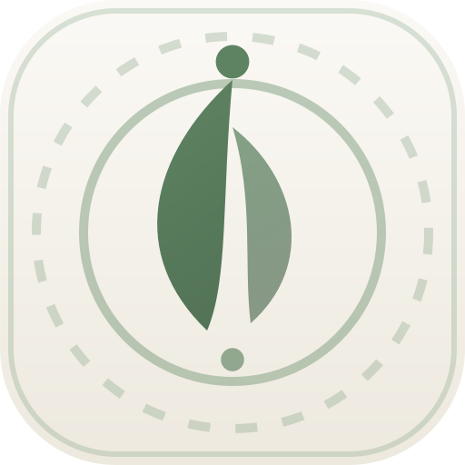

<div align="center">



# Still

### *One gentle thing, then it forgets you.*

A calm decision decompressor built for days when planning feels impossible.  
Still takes a raw, messy brain-dump and returns **exactly one small, physical, reversible action** that takes 10 minutes or less.

[](https://www.typescriptlang.org/)
[](https://react.dev/)
[](https://tailwindcss.com/)
[](https://threejs.org/)
[](https://vitejs.dev/)
[](LICENSE)

[Live Demo](#) • [Features](#key-features) • [Architecture](#system-flow--architecture) • [Getting Started](#quick-start) • [Deployment](#deployment) • [Privacy](#privacy--data-ethics)

</div>

---

## 🍃 Why Still Exists

Most productivity apps demand more executive function than an overwhelmed mind can provide:
- Complex Kanban boards and task lists demand categorization and prioritization.
- Streak counters and notifications create guilt loops when you fall behind.
- AI assistants overload you with 10-step action plans when you can barely start one thing.

**Still is the antidote.** It is not a to-do list, a project manager, or a streak tracker. It is an ephemeral refuge that clears the noise, suggests one single micro-step, and forgets everything the moment you close the tab.

---

## 🚫 What Still Refuses to Do

| Refusal | Why It Matters |
| :--- | :--- |
| **No Planning** | Will never output a multi-step roadmap or schedule. |
| **No Lists** | Never gives you a backlog of chores to stress over. |
| **No Accounts** | No sign-ups, passwords, email newsletters, or tracking cookies. |
| **No History in the Cloud** | Your brain-dump is never saved in a database. It is ephemeral. |
| **No Scores or Streaks** | No gamification, karma points, or guilt triggers. |
| **No Push Notifications** | Still never interrupts your day. You come to it only when you need it. |

---

## ✨ Key Features

- **🎯 Exactly One Action:** Generates one concrete physical step beginning with an approved gentle verb (*glance, drink, stretch, clear, open, step...*).
- **🛡️ Deterministic Zero-AI Validator:** Every model response passes through a strict heuristic validator ensuring single-step simplicity, word-count caps, no high-effort triggers (*decide, organize, reply, fix*), and non-negotiable $\le 10$ minute time-boxes.
- **🎨 3D Interactive Ambient Nature:** Built with Three.js featuring dynamic terrain shaders, ambient lighting, and mouse-reactive vistas (Forest, Water, Meadow).
- **🤖 Dual Inference Modes:**
  - **Hosted Mode:** Powered by Google's **Gemma 4** (`gemma-4-26b-a4b-it` / `gemma-4-31b-it`) with automatic quota protection, 40s timeout tolerance, and zero-retry on 429 errors.
  - **Local Mode (Ollama):** 100% offline edge inference via local Ollama (`ollama pull gemma4:e2b`). Nothing leaves your device.
- **❤️ Crisis & Safety Interceptor:** If a user expresses severe acute distress or self-harm keywords, Still halts model generation instantly and provides immediate, compassionate crisis support hotlines.
- **📱 PWA & Offline Support:** Installable as a Progressive Web App on mobile and desktop, backed by offline-curated fallback cards when disconnected.
- **🕰️ Ambient Reassurance Clock:** Optional grounding timekeeper with localized time display and subtle reassurance quotes.
- **🌿 Quiet Log (On-Device):** Private, optional on-device reflection for recurring burnout contexts, with exportable and purgeable local storage.

---

## 🔄 System Flow & Architecture

```
                    ┌─────────────────────────┐
                    │     User Brain-Dump     │
                    └────────────┬────────────┘
                                 │
                                 ▼
                     [ Safety & Distress Check ]
                    /                           \
         (Distress Detected)               (Safe / Neutral)
                  │                                │
                  ▼                                ▼
       ┌──────────────────────┐        [ Inference Router ]
       │  Immediate Compassion│       /                    \
       │   & Crisis Hotline   │ (Hosted Gemma 4)      (Local Ollama)
       └──────────────────────┘       │                     │
                                      ▼                     ▼
                             [ Google GenAI API ]     [ Local Ollama ]
                                      \                     /
                                       ▼                   ▼
                                 ┌─────────────────────────┐
                                 │   Zero-AI Validator     │
                                 │  • Exactly 1 step       │
                                 │  • Gentle verb check    │
                                 │  • ≤ 10 min time box    │
                                 │  • No multi-actions     │
                                 └────────────┬────────────┘
                                              │
                                              ▼
                                 ┌─────────────────────────┐
                                 │     One Gentle Card     │
                                 │   (Then it forgets you) │
                                 └─────────────────────────┘
```

---

## 🛠️ Tech Stack

### Frontend
- **Framework:** React 19 with TypeScript
- **Bundler:** Vite 8
- **Styling:** Tailwind CSS v4 & Custom Design Tokens
- **Animations:** Motion (`motion/react`)
- **Graphics:** Three.js (Procedural 3D nature environments with custom vertex/fragment shaders)
- **Icons:** Lucide React

### Backend
- **Server:** Node.js + Express
- **Runtime:** `tsx` (TypeScript Execute)
- **AI SDK:** `@google/genai` (Google GenAI SDK)
- **Protection:** In-memory sliding quota limiter (600 calls/day, 12 calls/min, 429 backoff)

---

## 🚀 Quick Start

### 1. Prerequisites
- **Node.js** v20.x or higher
- **npm** or **bun**
- (Optional) **Google Gemini API Key** for hosted Gemma 4 mode
- (Optional) **Ollama** for 100% offline local mode

### 2. Clone and Install
```bash
git clone https://github.com/vinit-tech-source/decision-decompressor.git
cd decision-decompressor
npm install
```

### 3. Configure Environment
Create a `.env` file in the root directory (refer to `.env.example`):
```env
# Optional: Set for Hosted Mode with Google Gemma 4
GEMINI_API_KEY="your-gemini-api-key-here"

# Server Port (default: 3000)
PORT=3000
```
> **Note:** If `GEMINI_API_KEY` is not provided, Still runs in offline-fallback mode with curated gentle cards, or you can switch to Local Ollama mode in Settings.

### 4. Run Development Server
```bash
npm run dev
```
Open **[http://localhost:3000](http://localhost:3000)** in your browser.

---

## 💻 Local Mode with Ollama (100% Offline)

If you prefer total local privacy without any external API calls:

1. **Install and run Ollama:**
   ```bash
   # Enable cross-origin requests from your Still app
   OLLAMA_ORIGINS="*" ollama serve
   ```

2. **Pull the recommended Gemma model:**
   ```bash
   ollama pull gemma4:e2b
   ```

3. **In the Still Web App:**
   - Click the **Gear icon** (Settings) in the top right.
   - Under **Inference Engine**, select **Local Ollama**.
   - Ensure the endpoint points to `http://localhost:11434`.

---

## 🧪 Testing & Validation

Still comes with a comprehensive test suite covering the deterministic validator, safety triggers, JSON extraction, and quota protections:

```bash
# Run unit tests
npm test

# Run TypeScript type-checking
npm run lint

# Build production bundle
npm run build
```

---

## 🌐 Deployment

Still is ready to deploy on any modern Node.js hosting platform (Render, Railway, Fly.io, or VPS).

### Deploy to Render (Web Service)

1. Connect your GitHub repository to [Render](https://render.com).
2. Create a new **Web Service**:
   - **Environment:** `Node`
   - **Build Command:** `npm install && npm run build`
   - **Start Command:** `npm start`
3. Add Environment Variables:
   - `GEMINI_API_KEY` = `your-gemini-api-key`
   - `NODE_ENV` = `production`
   - `PORT` = `10000` (or Render's default)

---

## 🔒 Privacy & Data Ethics

- **Zero Persistence:** No database is attached to Still. Your thoughts are never saved to disk.
- **Zero Logging of Prompts:** Server logs record only the HTTP status and latency. Brain-dump text and response content are never logged.
- **On-Device Diagnostics:** Debug panels, settings, and Quiet Log reflections reside exclusively in the user's browser `localStorage` and can be wiped with one click.
- **Safety First:** Still is designed for gentle decompression and is **not** a substitute for professional mental health care or therapy.

---

## 📄 License

This project is licensed under the [MIT License](LICENSE).

---

<div align="center">
<sub>Crafted with calm intent by <a href="https://github.com/vinit-tech-source">Vinit Shinde</a>.</sub>
</div>
